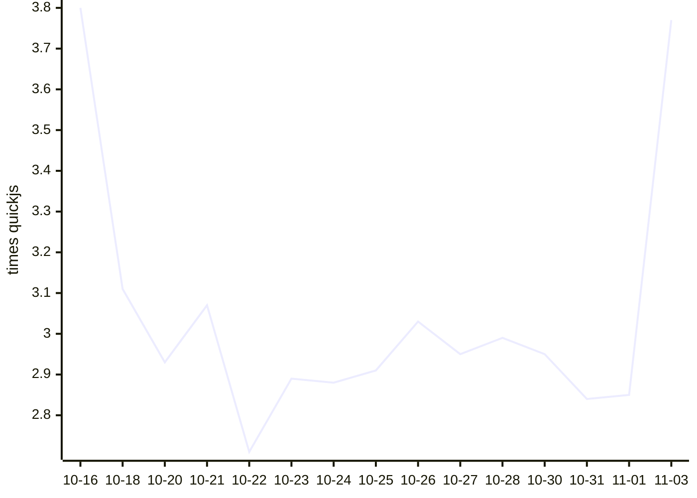

# Kahvi benchmark results

Written by `.github/workflows/bench.yml` from `bench/run.py` (see `bench/README.md` on main). Times are medians of wall time on a GitHub-hosted runner; ratios compare each engine with quickjs measured in the same run, so lower is faster.

## Kahvi over time

Geometric mean of Kahvi's time relative to quickjs, across the workloads both ran. Lower is faster.

## Latest run: 2026-11-03T09:38:44Z

Kahvi git b236288, 3 runs each, on Linux-7.0.0-1017-azure-x86_64-with-glibc2.39.

| Workload | kahvi | node | node-jitless | quickjs | boa | hermes |
|---|---|---|---|---|---|---|
| startup/empty | 0.006s (3.867x) | 0.018s (13.0x) | 0.019s (13.286x) | 0.001s | 0.009s (6.5x) | 0.003s (1.857x) |
| octane/richards | 10.260s (4.379x) | 0.085s (0.036x) | 1.143s (0.488x) | 2.343s | 11.086s (4.754x) | 1.282s (0.55x) |
| octane/deltablue | 9.381s (4.016x) | 0.097s (0.041x) | 1.072s (0.459x) | 2.336s | 12.357s (5.292x) | 1.380s (0.591x) |
| octane/crypto | 24.482s (3.403x) | 0.118s (0.038x) | 4.745s (0.66x) | 7.194s | 18.312s (5.885x) | 2.274s (0.731x) |
| octane/raytrace | 14.751s (4.135x) | 0.175s (0.049x) | 1.322s (0.371x) | 3.567s | 18.351s (5.134x) | 2.817s (0.788x) |
| octane/earley-boyer | 18.774s (4.896x) | 0.339s (0.047x) | 1.325s (0.346x) | 3.834s | 50.464s (6.928x) | 4.577s (0.628x) |
| octane/regexp | 20.389s (3.062x) | 0.184s (0.056x) | 0.883s (0.133x) | 6.658s | 24.676s (7.557x) | 2.005s (0.614x) |
| octane/splay | 1.520s (2.647x) | 0.158s (0.321x) | 0.254s (0.517x) | 0.491s | 1.847s (3.763x) | 0.321s (0.653x) |
| octane/navier-stokes | 7.030s (4.048x) | 0.112s (0.078x) | 1.342s (0.938x) | 1.430s | 6.527s (4.563x) | 1.174s (0.821x) |
| realworld/acorn | 4.798s | 0.164s | 0.463s | – | – | – |
| realworld/marked | 1.257s | 0.093s | 0.095s | – | – | – |
| realworld/prettier | 12.660s | 0.437s | 1.055s | – | – | – |
| realworld/terser | 11.048s | 0.533s | 0.915s | – | – | – |

| Engine | Version |
|---|---|
| kahvi | git b236288 |
| node | v22.23.4 |
| node-jitless | v22.23.4 |
| quickjs | 0.18.0 |
| boa | boa 0.22.0 |
| hermes | LLVM (http://llvm.org/): |

## History

| Date | Kahvi commit | Kahvi vs quickjs (geomean) | Workloads | File |
|---|---|---|---|---|
| 2026-11-03T09:38:44Z | git b236288 | 3.77x | 9 | [json](results/20261103T093844Z-b236288e30.json) |
| 2026-11-01T09:20:36Z | git 100ced3 | 2.85x | 9 | [json](results/20261101T092036Z-100ced3d4d.json) |
| 2026-10-31T08:29:36Z | git a3dc6de | 2.84x | 9 | [json](results/20261031T082936Z-a3dc6de88e.json) |
| 2026-10-30T08:43:18Z | git b75ecfe | 2.95x | 9 | [json](results/20261030T084318Z-b75ecfe641.json) |
| 2026-10-28T08:39:01Z | git 1a1d9f0 | 2.99x | 9 | [json](results/20261028T083901Z-1a1d9f0872.json) |
| 2026-10-27T07:57:12Z | git ab18b24 | 2.95x | 9 | [json](results/20261027T075712Z-ab18b2476d.json) |
| 2026-10-26T07:52:02Z | git 006e586 | 3.03x | 9 | [json](results/20261026T075202Z-006e58682a.json) |
| 2026-10-25T07:38:52Z | git 0614530 | 2.91x | 9 | [json](results/20261025T073852Z-06145300cb.json) |
| 2026-10-24T07:22:14Z | git 965eed5 | 2.88x | 9 | [json](results/20261024T072214Z-965eed51be.json) |
| 2026-10-23T07:37:01Z | git 7071998 | 2.89x | 9 | [json](results/20261023T073701Z-707199806e.json) |
| 2026-10-22T07:39:32Z | git f9066d9 | 2.71x | 9 | [json](results/20261022T073932Z-f9066d9e0c.json) |
| 2026-10-21T07:43:58Z | git 6195d71 | 3.07x | 9 | [json](results/20261021T074358Z-6195d71ab0.json) |
| 2026-10-20T07:39:19Z | git 34ce57b | 2.93x | 9 | [json](results/20261020T073919Z-34ce57be6c.json) |
| 2026-10-18T07:16:59Z | git e8d4c59 | 3.11x | 9 | [json](results/20261018T071659Z-e8d4c59b8e.json) |
| 2026-10-16T07:15:56Z | git 36694ea | 3.80x | 9 | [json](results/20261016T071556Z-36694eab43.json) |
