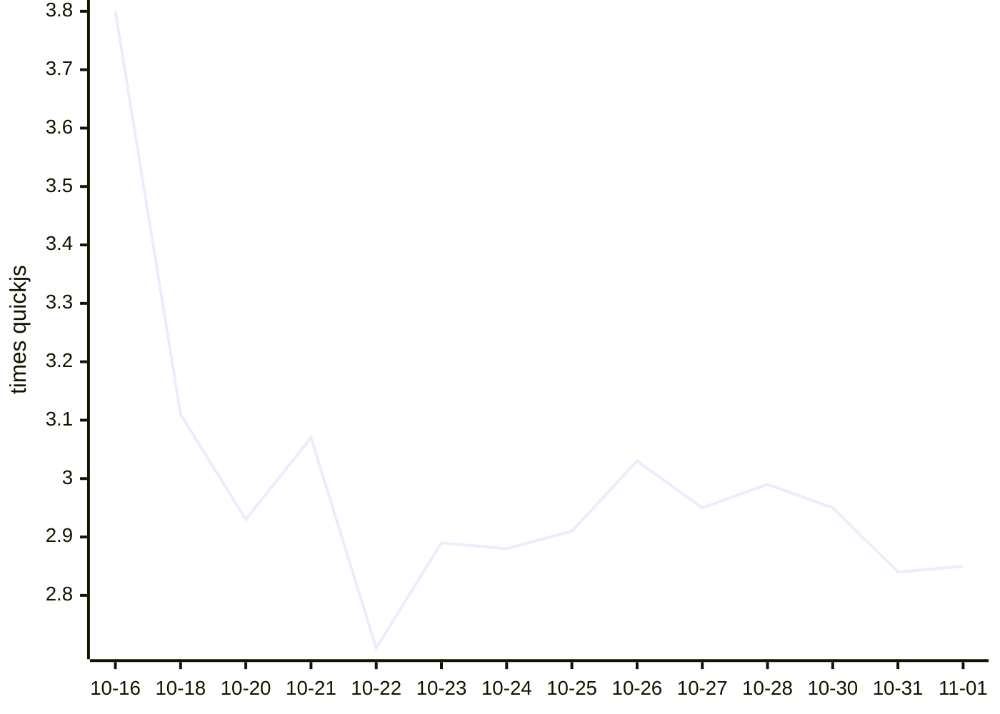

# Kahvi benchmark results

Written by `.github/workflows/bench.yml` from `bench/run.py` (see `bench/README.md` on main). Times are medians of wall time on a GitHub-hosted runner; ratios compare each engine with quickjs measured in the same run, so lower is faster.

## Kahvi over time

Geometric mean of Kahvi's time relative to quickjs, across the workloads both ran. Lower is faster.

## Latest run: 2026-11-01T09:20:36Z

Kahvi git 100ced3, 3 runs each, on Linux-7.0.0-1017-azure-x86_64-with-glibc2.39.

| Workload | kahvi | node | node-jitless | quickjs | boa | hermes |
|---|---|---|---|---|---|---|
| startup/empty | 0.003s (2.0x) | 0.020s (15.385x) | 0.022s (16.769x) | 0.001s | 0.009s (7.077x) | 0.002s (1.538x) |
| octane/richards | 10.293s (3.497x) | 0.087s (0.03x) | 1.128s (0.383x) | 2.943s | 12.045s (4.088x) | 1.274s (0.432x) |
| octane/deltablue | 8.031s (4.046x) | 0.092s (0.034x) | 0.890s (0.448x) | 1.985s | 12.549s (4.691x) | 1.385s (0.518x) |
| octane/crypto | 15.939s (1.462x) | 0.208s (0.015x) | 3.119s (0.286x) | 10.902s | 32.903s (2.389x) | 3.664s (0.266x) |
| octane/raytrace | 11.113s (3.67x) | 0.185s (0.046x) | 1.026s (0.339x) | 3.028s | 18.979s (4.763x) | 2.832s (0.711x) |
| octane/earley-boyer | 19.229s (4.431x) | 0.355s (0.043x) | 1.395s (0.321x) | 4.340s | 51.773s (6.236x) | 4.589s (0.553x) |
| octane/regexp | 20.130s (2.957x) | 0.173s (0.054x) | 0.885s (0.13x) | 6.807s | 23.583s (7.408x) | 1.973s (0.62x) |
| octane/splay | 1.368s (2.372x) | 0.164s (0.287x) | 0.259s (0.451x) | 0.573s | 1.904s (3.321x) | 0.339s (0.591x) |
| octane/navier-stokes | 6.934s (2.646x) | 0.110s (0.05x) | 1.300s (0.584x) | 2.225s | 6.508s (2.925x) | 1.183s (0.532x) |
| realworld/acorn | 3.802s | 0.170s | 0.468s | – | – | – |
| realworld/marked | 1.044s | 0.093s | 0.098s | – | – | – |
| realworld/prettier | 12.729s | 0.444s | 1.067s | – | – | – |
| realworld/terser | 11.190s | 0.552s | 0.958s | – | – | – |

| Engine | Version |
|---|---|
| kahvi | git 100ced3 |
| node | v22.23.4 |
| node-jitless | v22.23.4 |
| quickjs | 0.17.0 |
| boa | boa 0.22.0 |
| hermes | LLVM (http://llvm.org/): |

## History

| Date | Kahvi commit | Kahvi vs quickjs (geomean) | Workloads | File |
|---|---|---|---|---|
| 2026-11-01T09:20:36Z | git 100ced3 | 2.85x | 9 | [json](results/20261101T092036Z-100ced3d4d.json) |
| 2026-10-31T08:29:36Z | git a3dc6de | 2.84x | 9 | [json](results/20261031T082936Z-a3dc6de88e.json) |
| 2026-10-30T08:43:18Z | git b75ecfe | 2.95x | 9 | [json](results/20261030T084318Z-b75ecfe641.json) |
| 2026-10-28T08:39:01Z | git 1a1d9f0 | 2.99x | 9 | [json](results/20261028T083901Z-1a1d9f0872.json) |
| 2026-10-27T07:57:12Z | git ab18b24 | 2.95x | 9 | [json](results/20261027T075712Z-ab18b2476d.json) |
| 2026-10-26T07:52:02Z | git 006e586 | 3.03x | 9 | [json](results/20261026T075202Z-006e58682a.json) |
| 2026-10-25T07:38:52Z | git 0614530 | 2.91x | 9 | [json](results/20261025T073852Z-06145300cb.json) |
| 2026-10-24T07:22:14Z | git 965eed5 | 2.88x | 9 | [json](results/20261024T072214Z-965eed51be.json) |
| 2026-10-23T07:37:01Z | git 7071998 | 2.89x | 9 | [json](results/20261023T073701Z-707199806e.json) |
| 2026-10-22T07:39:32Z | git f9066d9 | 2.71x | 9 | [json](results/20261022T073932Z-f9066d9e0c.json) |
| 2026-10-21T07:43:58Z | git 6195d71 | 3.07x | 9 | [json](results/20261021T074358Z-6195d71ab0.json) |
| 2026-10-20T07:39:19Z | git 34ce57b | 2.93x | 9 | [json](results/20261020T073919Z-34ce57be6c.json) |
| 2026-10-18T07:16:59Z | git e8d4c59 | 3.11x | 9 | [json](results/20261018T071659Z-e8d4c59b8e.json) |
| 2026-10-16T07:15:56Z | git 36694ea | 3.80x | 9 | [json](results/20261016T071556Z-36694eab43.json) |
