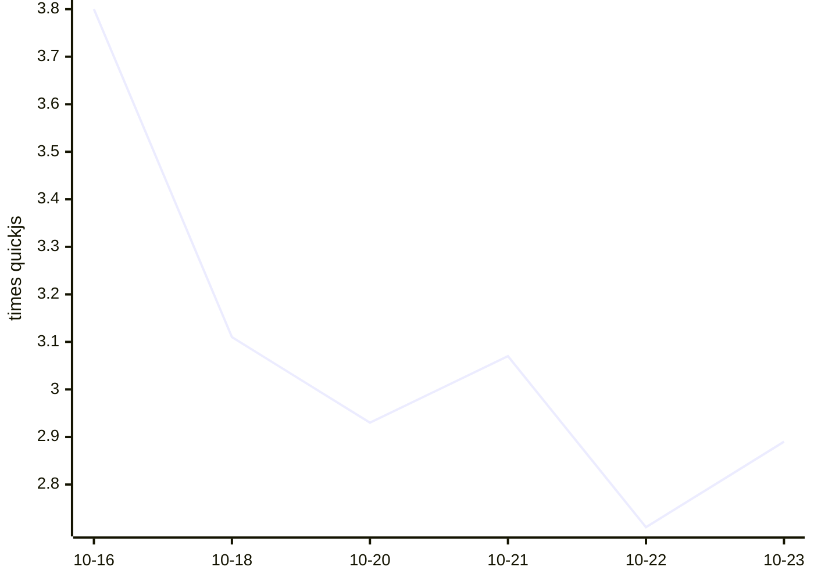

# Kahvi benchmark results

Written by `.github/workflows/bench.yml` from `bench/run.py` (see `bench/README.md` on main). Times are medians of wall time on a GitHub-hosted runner; ratios compare each engine with quickjs measured in the same run, so lower is faster.

## Kahvi over time

Geometric mean of Kahvi's time relative to quickjs, across the workloads both ran. Lower is faster.

## Latest run: 2026-10-23T07:37:01Z

Kahvi git 7071998, 3 runs each, on Linux-6.17.0-1022-azure-x86_64-with-glibc2.39.

| Workload | kahvi | node | node-jitless | quickjs | boa | hermes |
|---|---|---|---|---|---|---|
| startup/empty | 0.004s (2.769x) | 0.022s (14.8x) | 0.022s (14.933x) | 0.002s | 0.011s (7.4x) | 0.004s (2.733x) |
| octane/richards | 7.864s (3.922x) | 0.088s (0.03x) | 0.997s (0.497x) | 2.005s | 11.145s (3.798x) | 1.292s (0.44x) |
| octane/deltablue | 5.764s (4.117x) | 0.101s (0.038x) | 0.547s (0.39x) | 1.400s | 12.163s (4.528x) | 1.372s (0.511x) |
| octane/crypto | 18.486s (1.455x) | 0.213s (0.016x) | 3.628s (0.286x) | 12.709s | 25.897s (1.996x) | 2.641s (0.204x) |
| octane/raytrace | 8.169s (4.076x) | 0.178s (0.044x) | 0.705s (0.352x) | 2.004s | 18.462s (4.608x) | 2.880s (0.719x) |
| octane/earley-boyer | 33.716s (3.846x) | 0.351s (0.043x) | 2.680s (0.306x) | 8.768s | 49.789s (6.049x) | 4.556s (0.553x) |
| octane/regexp | 14.577s (2.856x) | 0.326s (0.048x) | 0.653s (0.128x) | 5.103s | 43.645s (6.375x) | 3.463s (0.506x) |
| octane/splay | 1.240s (2.059x) | 0.197s (0.275x) | 0.332s (0.464x) | 0.715s | 2.047s (2.861x) | 0.419s (0.586x) |
| octane/navier-stokes | 3.610s (2.336x) | 0.132s (0.05x) | 1.708s (0.651x) | 2.623s | 8.251s (3.146x) | 1.470s (0.561x) |
| realworld/acorn | 3.568s | 0.213s | 0.612s | – | – | – |
| realworld/marked | 1.134s | 0.124s | 0.135s | – | – | – |
| realworld/prettier | 7.893s | 0.601s | 1.540s | – | – | – |
| realworld/terser | 6.381s | 0.749s | 1.280s | – | – | – |

| Engine | Version |
|---|---|
| kahvi | git 7071998 |
| node | v22.23.3 |
| node-jitless | v22.23.3 |
| quickjs | 0.17.0 |
| boa | boa 0.22.0 |
| hermes | LLVM (http://llvm.org/): |

## History

| Date | Kahvi commit | Kahvi vs quickjs (geomean) | Workloads | File |
|---|---|---|---|---|
| 2026-10-23T07:37:01Z | git 7071998 | 2.89x | 9 | [json](results/20261023T073701Z-707199806e.json) |
| 2026-10-22T07:39:32Z | git f9066d9 | 2.71x | 9 | [json](results/20261022T073932Z-f9066d9e0c.json) |
| 2026-10-21T07:43:58Z | git 6195d71 | 3.07x | 9 | [json](results/20261021T074358Z-6195d71ab0.json) |
| 2026-10-20T07:39:19Z | git 34ce57b | 2.93x | 9 | [json](results/20261020T073919Z-34ce57be6c.json) |
| 2026-10-18T07:16:59Z | git e8d4c59 | 3.11x | 9 | [json](results/20261018T071659Z-e8d4c59b8e.json) |
| 2026-10-16T07:15:56Z | git 36694ea | 3.80x | 9 | [json](results/20261016T071556Z-36694eab43.json) |
