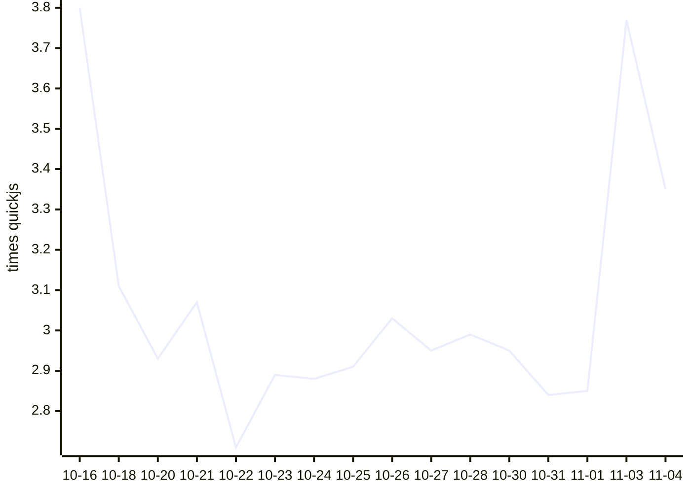

# Kahvi benchmark results

Written by `.github/workflows/bench.yml` from `bench/run.py` (see `bench/README.md` on main). Times are medians of wall time on a GitHub-hosted runner; ratios compare each engine with quickjs measured in the same run, so lower is faster.

## Kahvi over time

Geometric mean of Kahvi's time relative to quickjs, across the workloads both ran. Lower is faster.

## Latest run: 2026-11-04T09:22:01Z

Kahvi git 98ed7da, 3 runs each, on Linux-7.0.0-1017-azure-x86_64-with-glibc2.43, Linux-7.0.0-1019-azure-x86_64-with-glibc2.43.

| Workload | kahvi | node | node-jitless | quickjs | boa | hermes |
|---|---|---|---|---|---|---|
| startup/empty | 0.003s (1.765x) | 0.025s (14.111x) | 0.026s (14.389x) | 0.002s | 0.011s (6.167x) | 0.003s (1.5x) |
| octane/richards | 10.126s (4.384x) | 0.056s (0.032x) | 1.119s (0.485x) | 2.310s | 8.346s (4.816x) | 1.055s (0.609x) |
| octane/deltablue | 9.505s (4.051x) | 0.074s (0.043x) | 1.030s (0.439x) | 2.346s | 9.527s (5.477x) | 1.086s (0.624x) |
| octane/crypto | 23.822s (3.494x) | 0.174s (0.025x) | 4.731s (0.694x) | 6.817s | 35.570s (5.051x) | 3.692s (0.524x) |
| octane/raytrace | 14.635s (4.037x) | 0.126s (0.05x) | 1.297s (0.358x) | 3.625s | 14.488s (5.745x) | 1.842s (0.731x) |
| octane/earley-boyer | 18.912s (4.849x) | 0.289s (0.053x) | 1.315s (0.337x) | 3.900s | 39.597s (7.242x) | 3.421s (0.626x) |
| octane/regexp | 20.196s (3.037x) | 0.296s (0.044x) | 0.897s (0.135x) | 6.649s | 43.907s (6.587x) | 3.466s (0.52x) |
| octane/splay | 1.041s (2.011x) | 0.165s (0.264x) | 0.292s (0.468x) | 0.624s | 2.354s (3.775x) | 0.453s (0.726x) |
| octane/navier-stokes | 6.944s (4.021x) | 0.121s (0.071x) | 1.711s (0.999x) | 1.714s | 8.382s (4.891x) | 1.480s (0.864x) |
| realworld/acorn | 2.758s | 0.204s | 0.625s | – | – | – |
| realworld/marked | 0.824s | 0.105s | 0.133s | – | – | – |
| realworld/prettier | 12.158s | 0.531s | 1.566s | – | – | – |
| realworld/terser | 10.809s | 0.611s | 1.274s | – | – | – |

| Engine | Version |
|---|---|
| kahvi | git 98ed7da |
| node | v24.22.1 |
| node-jitless | v24.22.1 |
| quickjs | 0.18.0 |
| boa | boa 0.22.0 |
| hermes | LLVM (http://llvm.org/): |

## History

| Date | Kahvi commit | Kahvi vs quickjs (geomean) | Workloads | File |
|---|---|---|---|---|
| 2026-11-04T09:22:01Z | git 98ed7da | 3.35x | 9 | [json](results/20261104T092201Z-98ed7da385.json) |
| 2026-11-03T09:38:44Z | git b236288 | 3.77x | 9 | [json](results/20261103T093844Z-b236288e30.json) |
| 2026-11-01T09:20:36Z | git 100ced3 | 2.85x | 9 | [json](results/20261101T092036Z-100ced3d4d.json) |
| 2026-10-31T08:29:36Z | git a3dc6de | 2.84x | 9 | [json](results/20261031T082936Z-a3dc6de88e.json) |
| 2026-10-30T08:43:18Z | git b75ecfe | 2.95x | 9 | [json](results/20261030T084318Z-b75ecfe641.json) |
| 2026-10-28T08:39:01Z | git 1a1d9f0 | 2.99x | 9 | [json](results/20261028T083901Z-1a1d9f0872.json) |
| 2026-10-27T07:57:12Z | git ab18b24 | 2.95x | 9 | [json](results/20261027T075712Z-ab18b2476d.json) |
| 2026-10-26T07:52:02Z | git 006e586 | 3.03x | 9 | [json](results/20261026T075202Z-006e58682a.json) |
| 2026-10-25T07:38:52Z | git 0614530 | 2.91x | 9 | [json](results/20261025T073852Z-06145300cb.json) |
| 2026-10-24T07:22:14Z | git 965eed5 | 2.88x | 9 | [json](results/20261024T072214Z-965eed51be.json) |
| 2026-10-23T07:37:01Z | git 7071998 | 2.89x | 9 | [json](results/20261023T073701Z-707199806e.json) |
| 2026-10-22T07:39:32Z | git f9066d9 | 2.71x | 9 | [json](results/20261022T073932Z-f9066d9e0c.json) |
| 2026-10-21T07:43:58Z | git 6195d71 | 3.07x | 9 | [json](results/20261021T074358Z-6195d71ab0.json) |
| 2026-10-20T07:39:19Z | git 34ce57b | 2.93x | 9 | [json](results/20261020T073919Z-34ce57be6c.json) |
| 2026-10-18T07:16:59Z | git e8d4c59 | 3.11x | 9 | [json](results/20261018T071659Z-e8d4c59b8e.json) |
| 2026-10-16T07:15:56Z | git 36694ea | 3.80x | 9 | [json](results/20261016T071556Z-36694eab43.json) |
