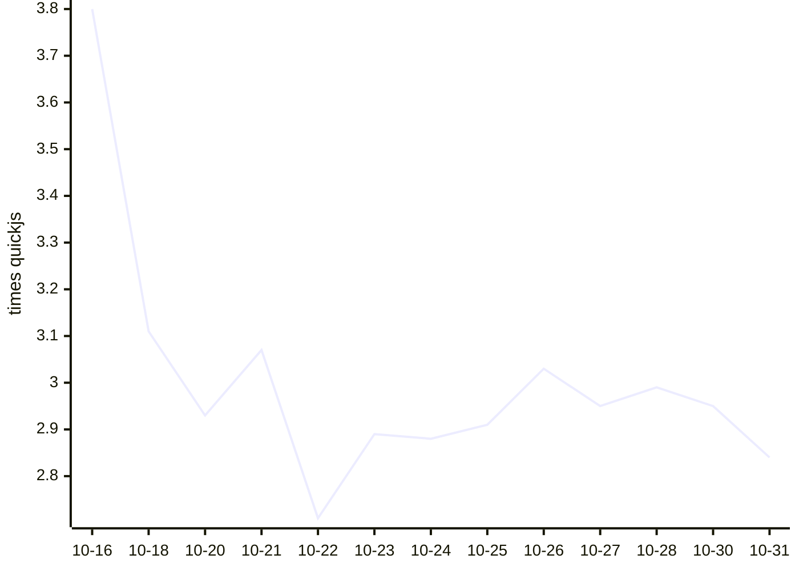

# Kahvi benchmark results

Written by `.github/workflows/bench.yml` from `bench/run.py` (see `bench/README.md` on main). Times are medians of wall time on a GitHub-hosted runner; ratios compare each engine with quickjs measured in the same run, so lower is faster.

## Kahvi over time

Geometric mean of Kahvi's time relative to quickjs, across the workloads both ran. Lower is faster.

## Latest run: 2026-10-31T08:29:36Z

Kahvi git a3dc6de, 3 runs each, on Linux-7.0.0-1017-azure-x86_64-with-glibc2.39.

| Workload | kahvi | node | node-jitless | quickjs | boa | hermes |
|---|---|---|---|---|---|---|
| startup/empty | 0.003s (1.812x) | 0.018s (15.417x) | 0.018s (14.75x) | 0.001s | 0.009s (7.5x) | 0.002s (1.833x) |
| octane/richards | 10.553s (3.567x) | 0.084s (0.042x) | 1.120s (0.379x) | 2.958s | 8.528s (4.28x) | 0.982s (0.493x) |
| octane/deltablue | 8.752s (4.043x) | 0.076s (0.038x) | 0.969s (0.448x) | 2.165s | 9.594s (4.83x) | 1.086s (0.547x) |
| octane/crypto | 23.819s (1.731x) | 0.200s (0.015x) | 4.986s (0.362x) | 13.762s | 32.686s (2.375x) | 3.669s (0.267x) |
| octane/raytrace | 12.265s (3.709x) | 0.140s (0.05x) | 1.119s (0.339x) | 3.306s | 14.559s (5.212x) | 1.888s (0.676x) |
| octane/earley-boyer | 17.709s (4.47x) | 0.217s (0.05x) | 1.267s (0.32x) | 3.962s | 27.033s (6.232x) | 2.450s (0.565x) |
| octane/regexp | 19.865s (2.911x) | 0.331s (0.048x) | 0.890s (0.13x) | 6.825s | 43.827s (6.363x) | 3.455s (0.502x) |
| octane/splay | 1.234s (2.101x) | 0.157s (0.289x) | 0.252s (0.464x) | 0.544s | 1.845s (3.39x) | 0.325s (0.598x) |
| octane/navier-stokes | 6.933s (2.642x) | 0.109s (0.049x) | 1.300s (0.588x) | 2.211s | 6.474s (2.928x) | 1.187s (0.537x) |
| realworld/acorn | 3.920s | 0.162s | 0.462s | – | – | – |
| realworld/marked | 1.015s | 0.094s | 0.093s | – | – | – |
| realworld/prettier | 12.402s | 0.433s | 1.050s | – | – | – |
| realworld/terser | 10.830s | 0.519s | 0.912s | – | – | – |

| Engine | Version |
|---|---|
| kahvi | git a3dc6de |
| node | v22.23.4 |
| node-jitless | v22.23.4 |
| quickjs | 0.17.0 |
| boa | boa 0.22.0 |
| hermes | LLVM (http://llvm.org/): |

## History

| Date | Kahvi commit | Kahvi vs quickjs (geomean) | Workloads | File |
|---|---|---|---|---|
| 2026-10-31T08:29:36Z | git a3dc6de | 2.84x | 9 | [json](results/20261031T082936Z-a3dc6de88e.json) |
| 2026-10-30T08:43:18Z | git b75ecfe | 2.95x | 9 | [json](results/20261030T084318Z-b75ecfe641.json) |
| 2026-10-28T08:39:01Z | git 1a1d9f0 | 2.99x | 9 | [json](results/20261028T083901Z-1a1d9f0872.json) |
| 2026-10-27T07:57:12Z | git ab18b24 | 2.95x | 9 | [json](results/20261027T075712Z-ab18b2476d.json) |
| 2026-10-26T07:52:02Z | git 006e586 | 3.03x | 9 | [json](results/20261026T075202Z-006e58682a.json) |
| 2026-10-25T07:38:52Z | git 0614530 | 2.91x | 9 | [json](results/20261025T073852Z-06145300cb.json) |
| 2026-10-24T07:22:14Z | git 965eed5 | 2.88x | 9 | [json](results/20261024T072214Z-965eed51be.json) |
| 2026-10-23T07:37:01Z | git 7071998 | 2.89x | 9 | [json](results/20261023T073701Z-707199806e.json) |
| 2026-10-22T07:39:32Z | git f9066d9 | 2.71x | 9 | [json](results/20261022T073932Z-f9066d9e0c.json) |
| 2026-10-21T07:43:58Z | git 6195d71 | 3.07x | 9 | [json](results/20261021T074358Z-6195d71ab0.json) |
| 2026-10-20T07:39:19Z | git 34ce57b | 2.93x | 9 | [json](results/20261020T073919Z-34ce57be6c.json) |
| 2026-10-18T07:16:59Z | git e8d4c59 | 3.11x | 9 | [json](results/20261018T071659Z-e8d4c59b8e.json) |
| 2026-10-16T07:15:56Z | git 36694ea | 3.80x | 9 | [json](results/20261016T071556Z-36694eab43.json) |
