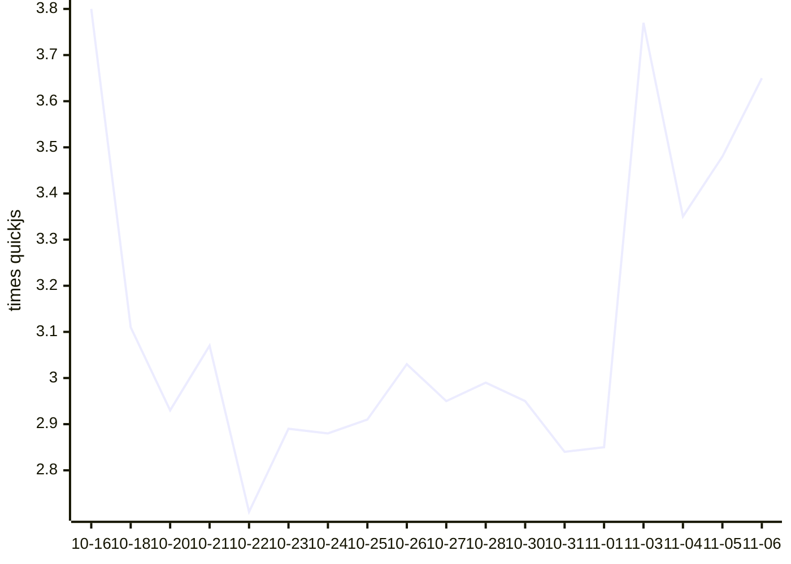

# Kahvi benchmark results

Written by `.github/workflows/bench.yml` from `bench/run.py` (see `bench/README.md` on main). Times are medians of wall time on a GitHub-hosted runner; ratios compare each engine with quickjs measured in the same run, so lower is faster.

## Kahvi over time

Geometric mean of Kahvi's time relative to quickjs, across the workloads both ran. Lower is faster.

## Latest run: 2026-11-06T09:28:43Z

Kahvi git c91b8e8, 3 runs each, on Linux-7.0.0-1019-azure-x86_64-with-glibc2.43.

| Workload | kahvi | node | node-jitless | quickjs | boa | hermes |
|---|---|---|---|---|---|---|
| startup/empty | 0.004s (2.333x) | 0.027s (11.696x) | 0.024s (10.478x) | 0.002s | 0.012s (5.217x) | 0.002s (1.043x) |
| octane/richards | 6.926s (4.436x) | 0.059s (0.034x) | 0.815s (0.522x) | 1.561s | 8.400s (4.815x) | 0.978s (0.561x) |
| octane/deltablue | 8.782s (4.801x) | 0.073s (0.042x) | 0.902s (0.493x) | 1.829s | 9.646s (5.489x) | 1.096s (0.624x) |
| octane/crypto | 14.499s (3.968x) | 0.175s (0.026x) | 2.724s (0.746x) | 3.654s | 34.466s (5.144x) | 3.668s (0.547x) |
| octane/raytrace | 12.228s (4.137x) | 0.120s (0.048x) | 1.076s (0.364x) | 2.956s | 14.649s (5.799x) | 1.852s (0.733x) |
| octane/earley-boyer | 27.191s (4.941x) | 0.387s (0.062x) | 1.794s (0.326x) | 5.503s | 45.595s (7.314x) | 4.112s (0.66x) |
| octane/regexp | 12.863s (2.985x) | 0.228s (0.045x) | 0.575s (0.133x) | 4.310s | 34.514s (6.839x) | 2.534s (0.502x) |
| octane/splay | 1.356s (2.387x) | 0.164s (0.282x) | 0.285s (0.491x) | 0.581s | 2.235s (3.847x) | 0.439s (0.755x) |
| octane/navier-stokes | 5.801s (4.039x) | 0.124s (0.074x) | 1.699s (1.01x) | 1.682s | 8.260s (4.91x) | 1.471s (0.875x) |
| realworld/acorn | 3.802s | 0.201s | 0.615s | – | – | – |
| realworld/marked | 1.093s | 0.105s | 0.129s | – | – | – |
| realworld/prettier | 9.624s | 0.503s | 1.527s | – | – | – |
| realworld/terser | 8.472s | 0.590s | 1.247s | – | – | – |

| Engine | Version |
|---|---|
| kahvi | git c91b8e8 |
| node | v24.22.2 |
| node-jitless | v24.22.2 |
| quickjs | 0.18.0 |
| boa | boa 0.22.0 |
| hermes | LLVM (http://llvm.org/): |

## History

| Date | Kahvi commit | Kahvi vs quickjs (geomean) | Workloads | File |
|---|---|---|---|---|
| 2026-11-06T09:28:43Z | git c91b8e8 | 3.65x | 9 | [json](results/20261106T092843Z-c91b8e8d8b.json) |
| 2026-11-05T09:34:11Z | git 663f862 | 3.48x | 9 | [json](results/20261105T093411Z-663f862552.json) |
| 2026-11-04T09:22:01Z | git 98ed7da | 3.35x | 9 | [json](results/20261104T092201Z-98ed7da385.json) |
| 2026-11-03T09:38:44Z | git b236288 | 3.77x | 9 | [json](results/20261103T093844Z-b236288e30.json) |
| 2026-11-01T09:20:36Z | git 100ced3 | 2.85x | 9 | [json](results/20261101T092036Z-100ced3d4d.json) |
| 2026-10-31T08:29:36Z | git a3dc6de | 2.84x | 9 | [json](results/20261031T082936Z-a3dc6de88e.json) |
| 2026-10-30T08:43:18Z | git b75ecfe | 2.95x | 9 | [json](results/20261030T084318Z-b75ecfe641.json) |
| 2026-10-28T08:39:01Z | git 1a1d9f0 | 2.99x | 9 | [json](results/20261028T083901Z-1a1d9f0872.json) |
| 2026-10-27T07:57:12Z | git ab18b24 | 2.95x | 9 | [json](results/20261027T075712Z-ab18b2476d.json) |
| 2026-10-26T07:52:02Z | git 006e586 | 3.03x | 9 | [json](results/20261026T075202Z-006e58682a.json) |
| 2026-10-25T07:38:52Z | git 0614530 | 2.91x | 9 | [json](results/20261025T073852Z-06145300cb.json) |
| 2026-10-24T07:22:14Z | git 965eed5 | 2.88x | 9 | [json](results/20261024T072214Z-965eed51be.json) |
| 2026-10-23T07:37:01Z | git 7071998 | 2.89x | 9 | [json](results/20261023T073701Z-707199806e.json) |
| 2026-10-22T07:39:32Z | git f9066d9 | 2.71x | 9 | [json](results/20261022T073932Z-f9066d9e0c.json) |
| 2026-10-21T07:43:58Z | git 6195d71 | 3.07x | 9 | [json](results/20261021T074358Z-6195d71ab0.json) |
| 2026-10-20T07:39:19Z | git 34ce57b | 2.93x | 9 | [json](results/20261020T073919Z-34ce57be6c.json) |
| 2026-10-18T07:16:59Z | git e8d4c59 | 3.11x | 9 | [json](results/20261018T071659Z-e8d4c59b8e.json) |
| 2026-10-16T07:15:56Z | git 36694ea | 3.80x | 9 | [json](results/20261016T071556Z-36694eab43.json) |
