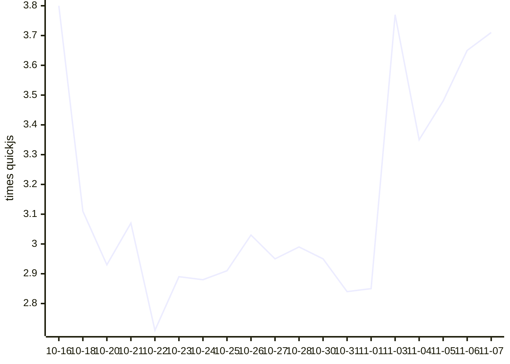

# Kahvi benchmark results

Written by `.github/workflows/bench.yml` from `bench/run.py` (see `bench/README.md` on main). Times are medians of wall time on a GitHub-hosted runner; ratios compare each engine with quickjs measured in the same run, so lower is faster.

## Kahvi over time

Geometric mean of Kahvi's time relative to quickjs, across the workloads both ran. Lower is faster.

## Latest run: 2026-11-07T08:51:32Z

Kahvi git bee1b4e, 3 runs each, on Linux-7.0.0-1019-azure-x86_64-with-glibc2.43.

| Workload | kahvi | node | node-jitless | quickjs | boa | hermes |
|---|---|---|---|---|---|---|
| startup/empty | 0.003s (2.538x) | 0.025s (15.875x) | 0.026s (16.062x) | 0.002s | 0.011s (7.187x) | 0.003s (1.625x) |
| octane/richards | 9.976s (4.28x) | 0.082s (0.035x) | 1.111s (0.477x) | 2.331s | 11.119s (4.79x) | 1.263s (0.544x) |
| octane/deltablue | 9.622s (4.141x) | 0.096s (0.041x) | 1.010s (0.435x) | 2.324s | 12.069s (5.148x) | 1.412s (0.602x) |
| octane/crypto | 12.755s (3.871x) | 0.182s (0.027x) | 2.527s (0.767x) | 3.295s | 36.032s (5.384x) | 3.680s (0.55x) |
| octane/raytrace | 14.594s (4.072x) | 0.159s (0.044x) | 1.277s (0.356x) | 3.584s | 18.581s (5.166x) | 2.885s (0.802x) |
| octane/earley-boyer | 27.248s (5.001x) | 0.362s (0.049x) | 1.748s (0.321x) | 5.449s | 50.859s (6.908x) | 4.596s (0.624x) |
| octane/regexp | 19.951s (2.987x) | 0.177s (0.055x) | 0.895s (0.134x) | 6.680s | 24.455s (7.552x) | 2.019s (0.624x) |
| octane/splay | 1.324s (2.614x) | 0.160s (0.259x) | 0.288s (0.465x) | 0.618s | 2.297s (3.716x) | 0.443s (0.716x) |
| octane/navier-stokes | 3.618s (4.816x) | 0.123s (0.073x) | 1.714s (1.014x) | 1.690s | 8.240s (4.874x) | 1.478s (0.874x) |
| realworld/acorn | 3.690s | 0.197s | 0.619s | – | – | – |
| realworld/marked | 1.016s | 0.104s | 0.129s | – | – | – |
| realworld/prettier | 7.066s | 0.519s | 1.541s | – | – | – |
| realworld/terser | 6.347s | 0.589s | 1.249s | – | – | – |

| Engine | Version |
|---|---|
| kahvi | git bee1b4e |
| node | v24.22.2 |
| node-jitless | v24.22.2 |
| quickjs | 0.18.0 |
| boa | boa 0.22.0 |
| hermes | LLVM (http://llvm.org/): |

## History

| Date | Kahvi commit | Kahvi vs quickjs (geomean) | Workloads | File |
|---|---|---|---|---|
| 2026-11-07T08:51:32Z | git bee1b4e | 3.71x | 9 | [json](results/20261107T085132Z-bee1b4ebd9.json) |
| 2026-11-06T09:28:43Z | git c91b8e8 | 3.65x | 9 | [json](results/20261106T092843Z-c91b8e8d8b.json) |
| 2026-11-05T09:34:11Z | git 663f862 | 3.48x | 9 | [json](results/20261105T093411Z-663f862552.json) |
| 2026-11-04T09:22:01Z | git 98ed7da | 3.35x | 9 | [json](results/20261104T092201Z-98ed7da385.json) |
| 2026-11-03T09:38:44Z | git b236288 | 3.77x | 9 | [json](results/20261103T093844Z-b236288e30.json) |
| 2026-11-01T09:20:36Z | git 100ced3 | 2.85x | 9 | [json](results/20261101T092036Z-100ced3d4d.json) |
| 2026-10-31T08:29:36Z | git a3dc6de | 2.84x | 9 | [json](results/20261031T082936Z-a3dc6de88e.json) |
| 2026-10-30T08:43:18Z | git b75ecfe | 2.95x | 9 | [json](results/20261030T084318Z-b75ecfe641.json) |
| 2026-10-28T08:39:01Z | git 1a1d9f0 | 2.99x | 9 | [json](results/20261028T083901Z-1a1d9f0872.json) |
| 2026-10-27T07:57:12Z | git ab18b24 | 2.95x | 9 | [json](results/20261027T075712Z-ab18b2476d.json) |
| 2026-10-26T07:52:02Z | git 006e586 | 3.03x | 9 | [json](results/20261026T075202Z-006e58682a.json) |
| 2026-10-25T07:38:52Z | git 0614530 | 2.91x | 9 | [json](results/20261025T073852Z-06145300cb.json) |
| 2026-10-24T07:22:14Z | git 965eed5 | 2.88x | 9 | [json](results/20261024T072214Z-965eed51be.json) |
| 2026-10-23T07:37:01Z | git 7071998 | 2.89x | 9 | [json](results/20261023T073701Z-707199806e.json) |
| 2026-10-22T07:39:32Z | git f9066d9 | 2.71x | 9 | [json](results/20261022T073932Z-f9066d9e0c.json) |
| 2026-10-21T07:43:58Z | git 6195d71 | 3.07x | 9 | [json](results/20261021T074358Z-6195d71ab0.json) |
| 2026-10-20T07:39:19Z | git 34ce57b | 2.93x | 9 | [json](results/20261020T073919Z-34ce57be6c.json) |
| 2026-10-18T07:16:59Z | git e8d4c59 | 3.11x | 9 | [json](results/20261018T071659Z-e8d4c59b8e.json) |
| 2026-10-16T07:15:56Z | git 36694ea | 3.80x | 9 | [json](results/20261016T071556Z-36694eab43.json) |
