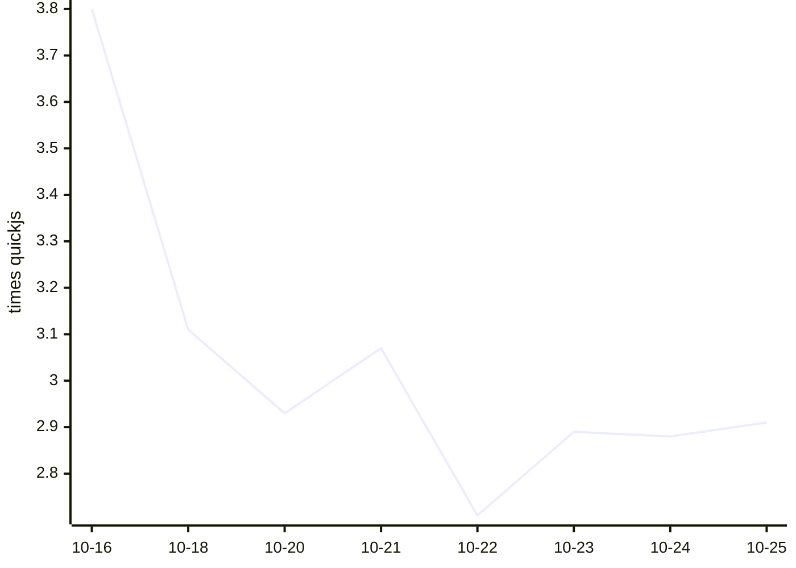

# Kahvi benchmark results

Written by `.github/workflows/bench.yml` from `bench/run.py` (see `bench/README.md` on main). Times are medians of wall time on a GitHub-hosted runner; ratios compare each engine with quickjs measured in the same run, so lower is faster.

## Kahvi over time

Geometric mean of Kahvi's time relative to quickjs, across the workloads both ran. Lower is faster.

## Latest run: 2026-10-25T07:38:52Z

Kahvi git 0614530, 3 runs each, on Linux-6.17.0-1022-azure-x86_64-with-glibc2.39.

| Workload | kahvi | node | node-jitless | quickjs | boa | hermes |
|---|---|---|---|---|---|---|
| startup/empty | 0.004s (3.417x) | 0.027s (14.0x) | 0.023s (12.053x) | 0.002s | 0.011s (5.842x) | 0.003s (1.632x) |
| octane/richards | 10.488s (3.542x) | 0.068s (0.033x) | 1.137s (0.384x) | 2.962s | 8.785s (4.356x) | 1.023s (0.507x) |
| octane/deltablue | 9.402s (3.442x) | 0.077s (0.038x) | 1.048s (0.384x) | 2.731s | 9.688s (4.84x) | 1.125s (0.562x) |
| octane/crypto | 23.690s (1.722x) | 0.215s (0.019x) | 4.898s (0.356x) | 13.761s | 28.594s (2.568x) | 2.945s (0.264x) |
| octane/raytrace | 13.500s (3.398x) | 0.136s (0.049x) | 1.321s (0.333x) | 3.973s | 14.654s (5.285x) | 1.863s (0.672x) |
| octane/earley-boyer | 32.035s (3.883x) | 0.201s (0.046x) | 2.450s (0.297x) | 8.251s | 28.307s (6.537x) | 2.392s (0.552x) |
| octane/regexp | 19.725s (2.923x) | 0.315s (0.046x) | 0.886s (0.131x) | 6.748s | 43.995s (6.472x) | 3.405s (0.501x) |
| octane/splay | 1.156s (2.065x) | 0.189s (0.262x) | 0.336s (0.466x) | 0.722s | 2.089s (2.894x) | 0.443s (0.613x) |
| octane/navier-stokes | 5.707s (2.586x) | 0.132s (0.051x) | 1.719s (0.657x) | 2.614s | 8.372s (3.203x) | 1.481s (0.566x) |
| realworld/acorn | 3.258s | 0.216s | 0.611s | – | – | – |
| realworld/marked | 1.032s | 0.126s | 0.139s | – | – | – |
| realworld/prettier | 10.062s | 0.625s | 1.552s | – | – | – |
| realworld/terser | 8.954s | 0.741s | 1.292s | – | – | – |

| Engine | Version |
|---|---|
| kahvi | git 0614530 |
| node | v22.23.3 |
| node-jitless | v22.23.3 |
| quickjs | 0.17.0 |
| boa | boa 0.22.0 |
| hermes | LLVM (http://llvm.org/): |

## History

| Date | Kahvi commit | Kahvi vs quickjs (geomean) | Workloads | File |
|---|---|---|---|---|
| 2026-10-25T07:38:52Z | git 0614530 | 2.91x | 9 | [json](results/20261025T073852Z-06145300cb.json) |
| 2026-10-24T07:22:14Z | git 965eed5 | 2.88x | 9 | [json](results/20261024T072214Z-965eed51be.json) |
| 2026-10-23T07:37:01Z | git 7071998 | 2.89x | 9 | [json](results/20261023T073701Z-707199806e.json) |
| 2026-10-22T07:39:32Z | git f9066d9 | 2.71x | 9 | [json](results/20261022T073932Z-f9066d9e0c.json) |
| 2026-10-21T07:43:58Z | git 6195d71 | 3.07x | 9 | [json](results/20261021T074358Z-6195d71ab0.json) |
| 2026-10-20T07:39:19Z | git 34ce57b | 2.93x | 9 | [json](results/20261020T073919Z-34ce57be6c.json) |
| 2026-10-18T07:16:59Z | git e8d4c59 | 3.11x | 9 | [json](results/20261018T071659Z-e8d4c59b8e.json) |
| 2026-10-16T07:15:56Z | git 36694ea | 3.80x | 9 | [json](results/20261016T071556Z-36694eab43.json) |
