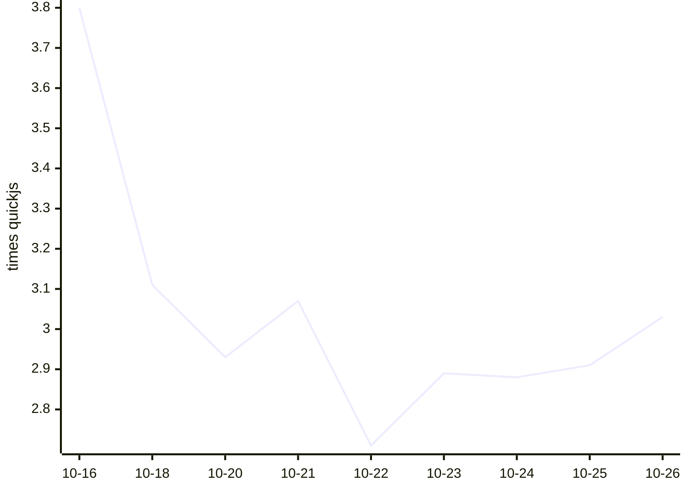

# Kahvi benchmark results

Written by `.github/workflows/bench.yml` from `bench/run.py` (see `bench/README.md` on main). Times are medians of wall time on a GitHub-hosted runner; ratios compare each engine with quickjs measured in the same run, so lower is faster.

## Kahvi over time

Geometric mean of Kahvi's time relative to quickjs, across the workloads both ran. Lower is faster.

## Latest run: 2026-10-26T07:52:02Z

Kahvi git 006e586, 3 runs each, on Linux-6.17.0-1022-azure-x86_64-with-glibc2.39.

| Workload | kahvi | node | node-jitless | quickjs | boa | hermes |
|---|---|---|---|---|---|---|
| startup/empty | 0.003s (2.667x) | 0.024s (15.733x) | 0.022s (14.667x) | 0.002s | 0.010s (6.867x) | 0.003s (2.0x) |
| octane/richards | 6.186s (4.136x) | 0.084s (0.028x) | 0.626s (0.418x) | 1.496s | 10.822s (3.684x) | 1.262s (0.43x) |
| octane/deltablue | 7.809s (3.951x) | 0.094s (0.035x) | 0.837s (0.423x) | 1.976s | 12.160s (4.572x) | 1.384s (0.52x) |
| octane/crypto | 12.785s (1.495x) | 0.201s (0.015x) | 2.551s (0.298x) | 8.553s | 33.544s (2.436x) | 3.653s (0.265x) |
| octane/raytrace | 11.448s (4.118x) | 0.173s (0.044x) | 0.947s (0.34x) | 2.780s | 18.242s (4.638x) | 2.841s (0.722x) |
| octane/earley-boyer | 31.448s (3.808x) | 0.338s (0.041x) | 2.460s (0.298x) | 8.259s | 50.651s (6.152x) | 4.551s (0.553x) |
| octane/regexp | 11.924s (3.688x) | 0.366s (0.053x) | 0.493s (0.153x) | 3.233s | 43.841s (6.322x) | 3.459s (0.499x) |
| octane/splay | 1.298s (2.115x) | 0.195s (0.29x) | 0.323s (0.482x) | 0.671s | 2.065s (3.076x) | 0.376s (0.56x) |
| octane/navier-stokes | 5.613s (2.712x) | 0.132s (0.051x) | 1.658s (0.635x) | 2.612s | 8.299s (3.177x) | 1.490s (0.571x) |
| realworld/acorn | 3.808s | 0.211s | 0.612s | – | – | – |
| realworld/marked | 1.046s | 0.125s | 0.134s | – | – | – |
| realworld/prettier | 11.183s | 0.599s | 1.538s | – | – | – |
| realworld/terser | 9.669s | 0.730s | 1.269s | – | – | – |

| Engine | Version |
|---|---|
| kahvi | git 006e586 |
| node | v22.23.3 |
| node-jitless | v22.23.3 |
| quickjs | 0.17.0 |
| boa | boa 0.22.0 |
| hermes | LLVM (http://llvm.org/): |

## History

| Date | Kahvi commit | Kahvi vs quickjs (geomean) | Workloads | File |
|---|---|---|---|---|
| 2026-10-26T07:52:02Z | git 006e586 | 3.03x | 9 | [json](results/20261026T075202Z-006e58682a.json) |
| 2026-10-25T07:38:52Z | git 0614530 | 2.91x | 9 | [json](results/20261025T073852Z-06145300cb.json) |
| 2026-10-24T07:22:14Z | git 965eed5 | 2.88x | 9 | [json](results/20261024T072214Z-965eed51be.json) |
| 2026-10-23T07:37:01Z | git 7071998 | 2.89x | 9 | [json](results/20261023T073701Z-707199806e.json) |
| 2026-10-22T07:39:32Z | git f9066d9 | 2.71x | 9 | [json](results/20261022T073932Z-f9066d9e0c.json) |
| 2026-10-21T07:43:58Z | git 6195d71 | 3.07x | 9 | [json](results/20261021T074358Z-6195d71ab0.json) |
| 2026-10-20T07:39:19Z | git 34ce57b | 2.93x | 9 | [json](results/20261020T073919Z-34ce57be6c.json) |
| 2026-10-18T07:16:59Z | git e8d4c59 | 3.11x | 9 | [json](results/20261018T071659Z-e8d4c59b8e.json) |
| 2026-10-16T07:15:56Z | git 36694ea | 3.80x | 9 | [json](results/20261016T071556Z-36694eab43.json) |
