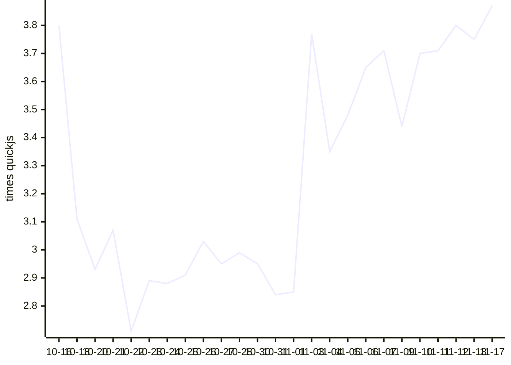

# Kahvi benchmark results

Written by `.github/workflows/bench.yml` from `bench/run.py` (see `bench/README.md` on main). Times are medians of wall time on a GitHub-hosted runner; ratios compare each engine with quickjs measured in the same run, so lower is faster.

## Kahvi over time

Geometric mean of Kahvi's time relative to quickjs, across the workloads both ran. Lower is faster.

## Latest run: 2026-11-17T10:47:26Z

Kahvi git d48bd0d, 3 runs each, on Linux-7.0.0-1019-azure-x86_64-with-glibc2.43.

| Workload | kahvi | node | node-jitless | quickjs | boa | hermes |
|---|---|---|---|---|---|---|
| startup/empty | 0.004s (2.643x) | 0.026s (13.737x) | 0.024s (12.474x) | 0.002s | 0.011s (5.895x) | 0.003s (1.526x) |
| octane/richards | 8.850s (5.098x) | 0.060s (0.049x) | 0.772s (0.445x) | 1.736s | 5.702s (4.7x) | 0.714s (0.588x) |
| octane/deltablue | 8.178s (4.669x) | 0.057s (0.049x) | 0.779s (0.445x) | 1.752s | 6.143s (5.244x) | 0.772s (0.659x) |
| octane/crypto | 25.135s (3.669x) | 0.205s (0.043x) | 4.721s (0.689x) | 6.851s | 28.732s (5.998x) | 2.971s (0.62x) |
| octane/raytrace | 12.363s (4.917x) | 0.091s (0.052x) | 0.899s (0.358x) | 2.514s | 9.722s (5.58x) | 1.354s (0.777x) |
| octane/earley-boyer | 26.808s (4.937x) | 0.277s (0.051x) | 1.733s (0.319x) | 5.430s | 39.281s (7.202x) | 3.437s (0.63x) |
| octane/regexp | 16.929s (3.311x) | 0.172s (0.054x) | 0.698s (0.137x) | 5.113s | 24.706s (7.739x) | 1.999s (0.626x) |
| octane/splay | 1.310s (2.617x) | 0.162s (0.258x) | 0.288s (0.46x) | 0.627s | 2.307s (3.68x) | 0.445s (0.71x) |
| octane/navier-stokes | 5.791s (4.028x) | 0.122s (0.073x) | 1.708s (1.016x) | 1.682s | 9.322s (5.543x) | 1.469s (0.874x) |
| realworld/acorn | 3.766s | 0.202s | 0.617s | – | – | – |
| realworld/marked | 1.013s | 0.102s | 0.131s | – | – | – |
| realworld/prettier | 9.850s | 0.522s | 1.532s | – | – | – |
| realworld/terser | 8.709s | 0.590s | 1.265s | – | – | – |

| Engine | Version |
|---|---|
| kahvi | git d48bd0d |
| node | v24.22.2 |
| node-jitless | v24.22.2 |
| quickjs | 0.18.0 |
| boa | boa 0.22.0 |
| hermes | LLVM (http://llvm.org/): |

## History

| Date | Kahvi commit | Kahvi vs quickjs (geomean) | Workloads | File |
|---|---|---|---|---|
| 2026-11-17T10:47:26Z | git d48bd0d | 3.87x | 9 | [json](results/20261117T104726Z-d48bd0d693.json) |
| 2026-11-13T09:36:46Z | git 16a110e | 3.75x | 9 | [json](results/20261113T093646Z-16a110ed67.json) |
| 2026-11-12T09:54:03Z | git 966f56b | 3.80x | 9 | [json](results/20261112T095403Z-966f56bce0.json) |
| 2026-11-11T09:30:33Z | git deec975 | 3.71x | 9 | [json](results/20261111T093033Z-deec975782.json) |
| 2026-11-10T09:56:08Z | git d130077 | 3.70x | 9 | [json](results/20261110T095608Z-d13007748a.json) |
| 2026-11-09T09:53:46Z | git 0ee82a5 | 3.44x | 9 | [json](results/20261109T095346Z-0ee82a5dcc.json) |
| 2026-11-07T08:51:32Z | git bee1b4e | 3.71x | 9 | [json](results/20261107T085132Z-bee1b4ebd9.json) |
| 2026-11-06T09:28:43Z | git c91b8e8 | 3.65x | 9 | [json](results/20261106T092843Z-c91b8e8d8b.json) |
| 2026-11-05T09:34:11Z | git 663f862 | 3.48x | 9 | [json](results/20261105T093411Z-663f862552.json) |
| 2026-11-04T09:22:01Z | git 98ed7da | 3.35x | 9 | [json](results/20261104T092201Z-98ed7da385.json) |
| 2026-11-03T09:38:44Z | git b236288 | 3.77x | 9 | [json](results/20261103T093844Z-b236288e30.json) |
| 2026-11-01T09:20:36Z | git 100ced3 | 2.85x | 9 | [json](results/20261101T092036Z-100ced3d4d.json) |
| 2026-10-31T08:29:36Z | git a3dc6de | 2.84x | 9 | [json](results/20261031T082936Z-a3dc6de88e.json) |
| 2026-10-30T08:43:18Z | git b75ecfe | 2.95x | 9 | [json](results/20261030T084318Z-b75ecfe641.json) |
| 2026-10-28T08:39:01Z | git 1a1d9f0 | 2.99x | 9 | [json](results/20261028T083901Z-1a1d9f0872.json) |
| 2026-10-27T07:57:12Z | git ab18b24 | 2.95x | 9 | [json](results/20261027T075712Z-ab18b2476d.json) |
| 2026-10-26T07:52:02Z | git 006e586 | 3.03x | 9 | [json](results/20261026T075202Z-006e58682a.json) |
| 2026-10-25T07:38:52Z | git 0614530 | 2.91x | 9 | [json](results/20261025T073852Z-06145300cb.json) |
| 2026-10-24T07:22:14Z | git 965eed5 | 2.88x | 9 | [json](results/20261024T072214Z-965eed51be.json) |
| 2026-10-23T07:37:01Z | git 7071998 | 2.89x | 9 | [json](results/20261023T073701Z-707199806e.json) |
| 2026-10-22T07:39:32Z | git f9066d9 | 2.71x | 9 | [json](results/20261022T073932Z-f9066d9e0c.json) |
| 2026-10-21T07:43:58Z | git 6195d71 | 3.07x | 9 | [json](results/20261021T074358Z-6195d71ab0.json) |
| 2026-10-20T07:39:19Z | git 34ce57b | 2.93x | 9 | [json](results/20261020T073919Z-34ce57be6c.json) |
| 2026-10-18T07:16:59Z | git e8d4c59 | 3.11x | 9 | [json](results/20261018T071659Z-e8d4c59b8e.json) |
| 2026-10-16T07:15:56Z | git 36694ea | 3.80x | 9 | [json](results/20261016T071556Z-36694eab43.json) |
