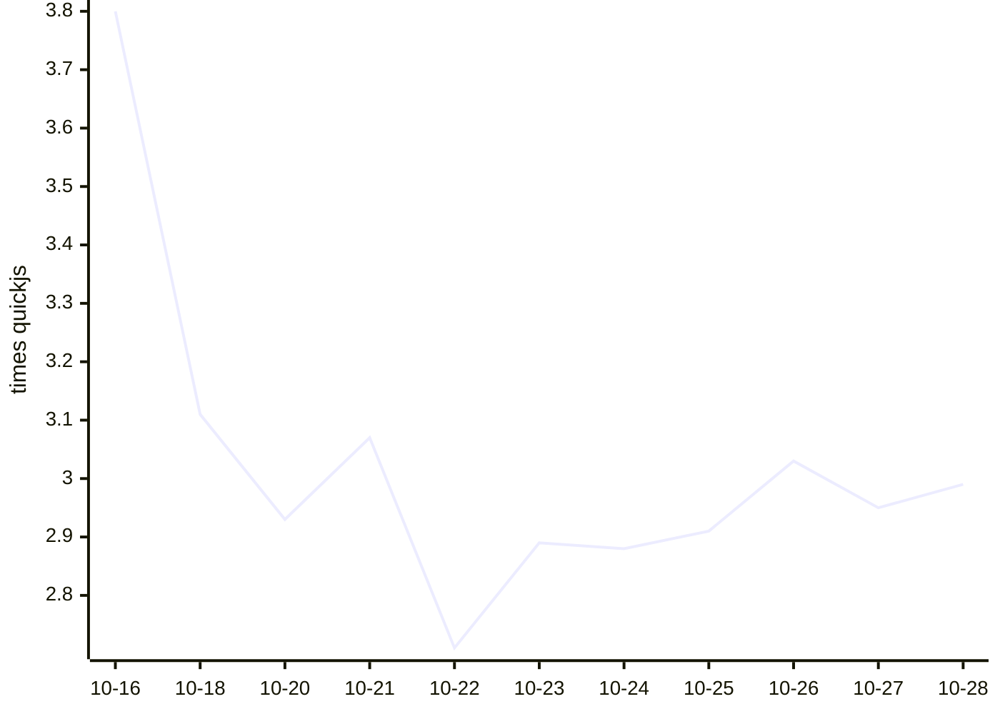

# Kahvi benchmark results

Written by `.github/workflows/bench.yml` from `bench/run.py` (see `bench/README.md` on main). Times are medians of wall time on a GitHub-hosted runner; ratios compare each engine with quickjs measured in the same run, so lower is faster.

## Kahvi over time

Geometric mean of Kahvi's time relative to quickjs, across the workloads both ran. Lower is faster.

## Latest run: 2026-10-28T08:39:01Z

Kahvi git 1a1d9f0, 3 runs each, on Linux-6.17.0-1022-azure-x86_64-with-glibc2.39, Linux-7.0.0-1017-azure-x86_64-with-glibc2.39.

| Workload | kahvi | node | node-jitless | quickjs | boa | hermes |
|---|---|---|---|---|---|---|
| startup/empty | 0.004s (3.0x) | 0.023s (13.706x) | 0.023s (13.765x) | 0.002s | 0.011s (6.176x) | 0.003s (2.0x) |
| octane/richards | 11.369s (4.441x) | 0.053s (0.035x) | 1.047s (0.409x) | 2.560s | 6.096s (4.027x) | 0.755s (0.499x) |
| octane/deltablue | 9.533s (3.579x) | 0.062s (0.044x) | 1.041s (0.391x) | 2.664s | 6.633s (4.64x) | 0.797s (0.557x) |
| octane/crypto | 18.766s (1.687x) | 0.206s (0.015x) | 3.625s (0.326x) | 11.126s | 33.323s (2.414x) | 3.664s (0.265x) |
| octane/raytrace | 13.788s (3.471x) | 0.110s (0.053x) | 1.359s (0.342x) | 3.972s | 10.140s (4.932x) | 1.419s (0.69x) |
| octane/earley-boyer | 32.402s (3.935x) | 0.346s (0.042x) | 2.432s (0.295x) | 8.234s | 50.642s (6.115x) | 4.561s (0.551x) |
| octane/regexp | 21.182s (3.137x) | 0.313s (0.046x) | 0.848s (0.126x) | 6.751s | 43.659s (6.371x) | 3.466s (0.506x) |
| octane/splay | 1.464s (2.057x) | 0.197s (0.279x) | 0.331s (0.469x) | 0.706s | 2.075s (2.939x) | 0.420s (0.595x) |
| octane/navier-stokes | 7.039s (2.686x) | 0.133s (0.051x) | 1.743s (0.668x) | 2.608s | 8.273s (3.172x) | 1.479s (0.567x) |
| realworld/acorn | 4.811s | 0.217s | 0.607s | – | – | – |
| realworld/marked | 1.248s | 0.119s | 0.138s | – | – | – |
| realworld/prettier | 12.712s | 0.591s | 1.550s | – | – | – |
| realworld/terser | 11.240s | 0.747s | 1.282s | – | – | – |

| Engine | Version |
|---|---|
| kahvi | git 1a1d9f0 |
| node | v22.23.3 |
| node-jitless | v22.23.3 |
| quickjs | 0.17.0 |
| boa | boa 0.22.0 |
| hermes | LLVM (http://llvm.org/): |

## History

| Date | Kahvi commit | Kahvi vs quickjs (geomean) | Workloads | File |
|---|---|---|---|---|
| 2026-10-28T08:39:01Z | git 1a1d9f0 | 2.99x | 9 | [json](results/20261028T083901Z-1a1d9f0872.json) |
| 2026-10-27T07:57:12Z | git ab18b24 | 2.95x | 9 | [json](results/20261027T075712Z-ab18b2476d.json) |
| 2026-10-26T07:52:02Z | git 006e586 | 3.03x | 9 | [json](results/20261026T075202Z-006e58682a.json) |
| 2026-10-25T07:38:52Z | git 0614530 | 2.91x | 9 | [json](results/20261025T073852Z-06145300cb.json) |
| 2026-10-24T07:22:14Z | git 965eed5 | 2.88x | 9 | [json](results/20261024T072214Z-965eed51be.json) |
| 2026-10-23T07:37:01Z | git 7071998 | 2.89x | 9 | [json](results/20261023T073701Z-707199806e.json) |
| 2026-10-22T07:39:32Z | git f9066d9 | 2.71x | 9 | [json](results/20261022T073932Z-f9066d9e0c.json) |
| 2026-10-21T07:43:58Z | git 6195d71 | 3.07x | 9 | [json](results/20261021T074358Z-6195d71ab0.json) |
| 2026-10-20T07:39:19Z | git 34ce57b | 2.93x | 9 | [json](results/20261020T073919Z-34ce57be6c.json) |
| 2026-10-18T07:16:59Z | git e8d4c59 | 3.11x | 9 | [json](results/20261018T071659Z-e8d4c59b8e.json) |
| 2026-10-16T07:15:56Z | git 36694ea | 3.80x | 9 | [json](results/20261016T071556Z-36694eab43.json) |
