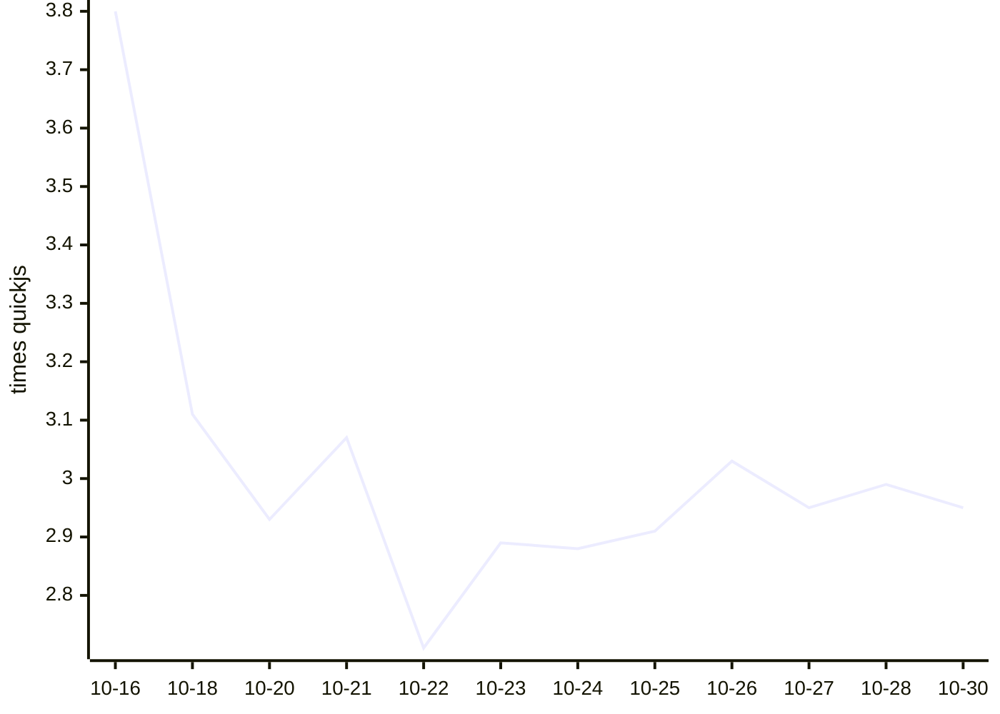

# Kahvi benchmark results

Written by `.github/workflows/bench.yml` from `bench/run.py` (see `bench/README.md` on main). Times are medians of wall time on a GitHub-hosted runner; ratios compare each engine with quickjs measured in the same run, so lower is faster.

## Kahvi over time

Geometric mean of Kahvi's time relative to quickjs, across the workloads both ran. Lower is faster.

## Latest run: 2026-10-30T08:43:18Z

Kahvi git b75ecfe, 3 runs each, on Linux-7.0.0-1017-azure-x86_64-with-glibc2.39.

| Workload | kahvi | node | node-jitless | quickjs | boa | hermes |
|---|---|---|---|---|---|---|
| startup/empty | 0.004s (3.143x) | 0.020s (13.467x) | 0.020s (13.467x) | 0.002s | 0.010s (6.467x) | 0.002s (1.4x) |
| octane/richards | 10.287s (3.49x) | 0.054s (0.035x) | 1.116s (0.379x) | 2.947s | 5.909s (3.875x) | 0.749s (0.491x) |
| octane/deltablue | 9.563s (3.596x) | 0.061s (0.043x) | 1.075s (0.404x) | 2.659s | 6.676s (4.67x) | 0.815s (0.57x) |
| octane/crypto | 23.584s (1.713x) | 0.231s (0.017x) | 4.790s (0.348x) | 13.764s | 33.504s (2.435x) | 3.675s (0.267x) |
| octane/raytrace | 14.544s (3.628x) | 0.115s (0.056x) | 1.332s (0.332x) | 4.008s | 10.167s (4.908x) | 1.434s (0.692x) |
| octane/earley-boyer | 32.131s (3.892x) | 0.276s (0.049x) | 2.461s (0.298x) | 8.256s | 35.252s (6.242x) | 3.036s (0.538x) |
| octane/regexp | 20.069s (2.964x) | 0.187s (0.054x) | 0.886s (0.131x) | 6.770s | 24.845s (7.214x) | 2.032s (0.59x) |
| octane/splay | 1.509s (2.249x) | 0.163s (0.28x) | 0.256s (0.441x) | 0.579s | 1.904s (3.286x) | 0.320s (0.553x) |
| octane/navier-stokes | 6.955s (2.654x) | 0.111s (0.05x) | 1.303s (0.589x) | 2.214s | 6.491s (2.932x) | 1.185s (0.535x) |
| realworld/acorn | 4.852s | 0.165s | 0.466s | – | – | – |
| realworld/marked | 1.256s | 0.094s | 0.096s | – | – | – |
| realworld/prettier | 12.123s | 0.446s | 1.068s | – | – | – |
| realworld/terser | 10.696s | 0.555s | 0.960s | – | – | – |

| Engine | Version |
|---|---|
| kahvi | git b75ecfe |
| node | v22.23.4 |
| node-jitless | v22.23.4 |
| quickjs | 0.17.0 |
| boa | boa 0.22.0 |
| hermes | LLVM (http://llvm.org/): |

## History

| Date | Kahvi commit | Kahvi vs quickjs (geomean) | Workloads | File |
|---|---|---|---|---|
| 2026-10-30T08:43:18Z | git b75ecfe | 2.95x | 9 | [json](results/20261030T084318Z-b75ecfe641.json) |
| 2026-10-28T08:39:01Z | git 1a1d9f0 | 2.99x | 9 | [json](results/20261028T083901Z-1a1d9f0872.json) |
| 2026-10-27T07:57:12Z | git ab18b24 | 2.95x | 9 | [json](results/20261027T075712Z-ab18b2476d.json) |
| 2026-10-26T07:52:02Z | git 006e586 | 3.03x | 9 | [json](results/20261026T075202Z-006e58682a.json) |
| 2026-10-25T07:38:52Z | git 0614530 | 2.91x | 9 | [json](results/20261025T073852Z-06145300cb.json) |
| 2026-10-24T07:22:14Z | git 965eed5 | 2.88x | 9 | [json](results/20261024T072214Z-965eed51be.json) |
| 2026-10-23T07:37:01Z | git 7071998 | 2.89x | 9 | [json](results/20261023T073701Z-707199806e.json) |
| 2026-10-22T07:39:32Z | git f9066d9 | 2.71x | 9 | [json](results/20261022T073932Z-f9066d9e0c.json) |
| 2026-10-21T07:43:58Z | git 6195d71 | 3.07x | 9 | [json](results/20261021T074358Z-6195d71ab0.json) |
| 2026-10-20T07:39:19Z | git 34ce57b | 2.93x | 9 | [json](results/20261020T073919Z-34ce57be6c.json) |
| 2026-10-18T07:16:59Z | git e8d4c59 | 3.11x | 9 | [json](results/20261018T071659Z-e8d4c59b8e.json) |
| 2026-10-16T07:15:56Z | git 36694ea | 3.80x | 9 | [json](results/20261016T071556Z-36694eab43.json) |
